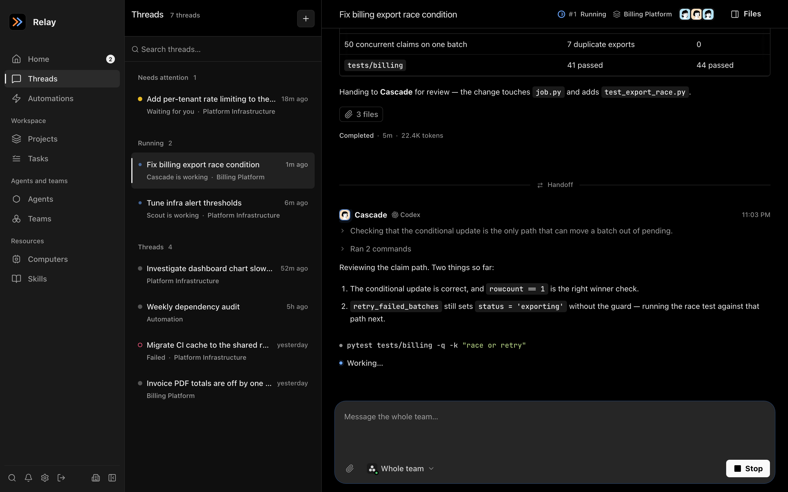
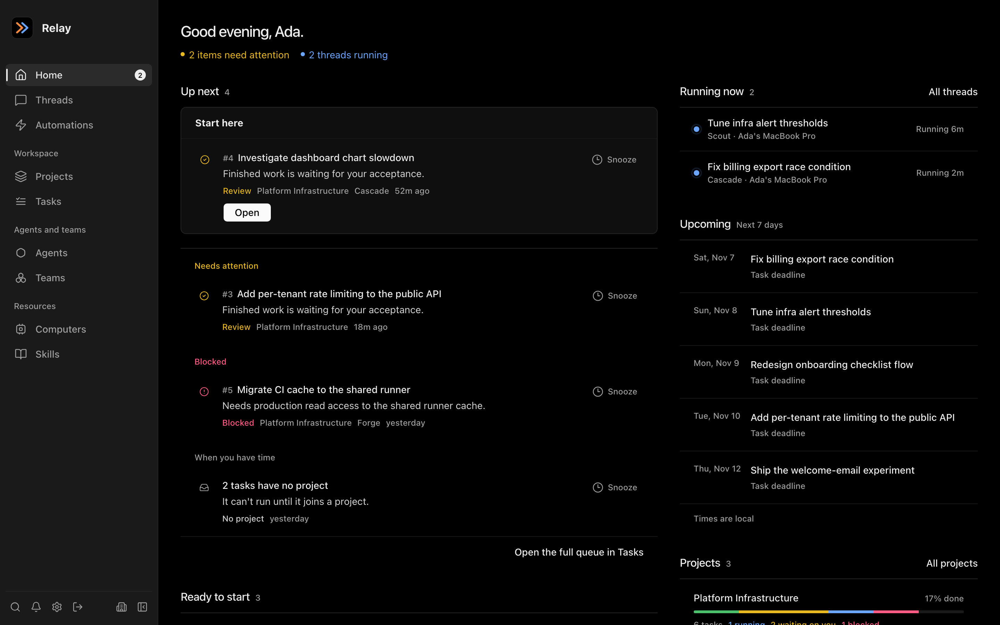
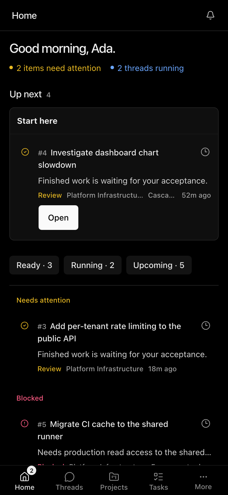
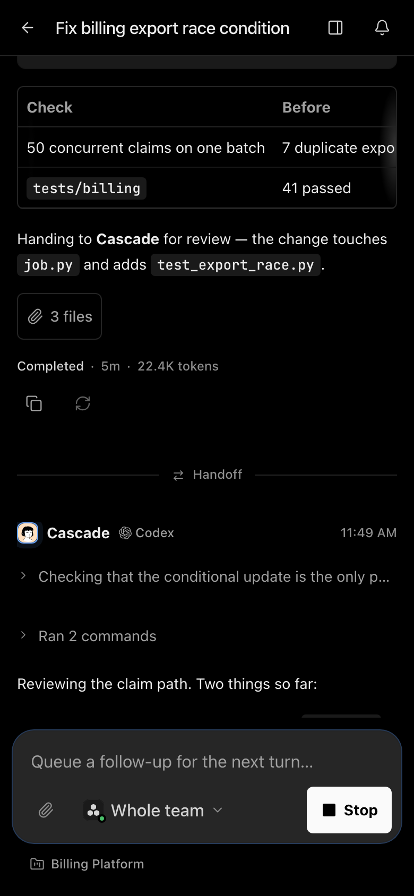
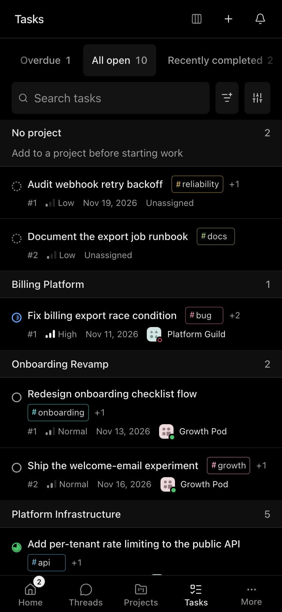

# Relay

<p align="center">
  
</p>

<p align="center"><strong>Relay — The control plane for your AI workforce</strong></p>

<p align="center">
  <a href="https://www.producthunt.com/products/relay-37?embed=true&amp;utm_source=badge-featured&amp;utm_medium=badge&amp;utm_campaign=badge-relay-e217251c-35b5-458f-a5eb-f62eaa573c22" target="_blank" rel="noopener noreferrer"></a>
</p>

<p align="center">
  <a href="README.md">English</a> ·
  <a href="README.zh-CN.md">简体中文</a> ·
  <a href="README.zh-TW.md">繁體中文</a>
</p>

Run AI agents on your own computers, coordinate them as teams, and follow their work from your desktop or phone. Relay supports Codex, [Claude Code](https://github.com/anthropics/claude-code), Pi, OpenCode, and Kimi.

The backend coordinates work; daemons execute it on personal or managed computers, directly on the host or inside a [BoxLite](https://github.com/boxlite-ai/boxlite) sandbox.

<p align="center">
  
</p>

## Features

- **Home and threads** — See what needs your attention, follow live agent output, answer questions, and review results.
- **Tasks and projects** — Assign work, track priorities and due dates, and keep shared context, files, and run history together.
- **Agents and teams** — Choose runtimes, models, roles, and versioned skills. Work Solo, Build → Review, Pipeline, or Lead-led.
- **Automations** — Trigger work on a schedule, from task or run events, through a webhook, or with Run now.
- **Connections and MCP** — Give work scoped access to GitHub issue reads. Agents can manage standalone tasks and automations through Relay MCP; Project Leads can manage project work.
- **Computers and administration** — Manage execution hosts, runtime readiness, users, activity, and token usage.
- **Desktop and mobile** — Use responsive views in the browser or [install Relay as an app](docs/guides/pwa.md).

## Screenshots

<p align="center">
  
</p>

<p align="center">
  
  
  
</p>

Current UI, dark theme, demo data. Regenerate with [`capture.mjs`](script/readme-snapshots/capture.mjs); add `--mobile` for phone views.

## Quick start

You need Node.js 22.19+, npm, Python 3.12+, [uv](https://docs.astral.sh/uv/), and PostgreSQL. For the default BoxLite sandbox, you also need Docker, hardware virtualization, and credentials for the agents you plan to use.

Run the following commands from the repository root.

### 1. Install and configure

```bash
npm install
npm run build
```

Copy the environment examples and add your agent credentials (details in [Local Development](docs/local-development.md)):

```bash
cp backend/.env.example backend/.env
cp web/.env.example web/.env.local
cp packages/.env.example packages/.env
```

### 2. Prepare the database and admin account

Relay stores sessions, tasks, events, and artifacts in PostgreSQL. Create the role and database specified by `RELAY_DATABASE_URL` in `backend/.env`. The example uses role `relay` and database `relay` on `localhost:5432`. Then apply the migrations:

```bash
make backend-migrate
```

Create the first admin account (there is no default password):

```bash
script/init_users.sh --password 'choose-a-strong-password'
```

### 3. Start the services

Start each service in its own terminal:

```bash
make backend                     # control plane on 127.0.0.1:8790
make daemon SANDBOX_ID=node_dev  # execution node connected to the backend
make web                         # web UI on 127.0.0.1:5000
```

Open <http://127.0.0.1:5000> and sign in as `admin`.

Tests, database migrations, the supervisor, pre-commit hooks, and shutdown commands are covered in [Local Development](docs/local-development.md).

## Learn more

[Documentation](docs/README.md) · [Local development](docs/local-development.md) · [Deployment](deploy/README.md) · [Contributing](CONTRIBUTING.md)

## License

[MIT](LICENSE). Third-party components and assets retain their own licenses.
