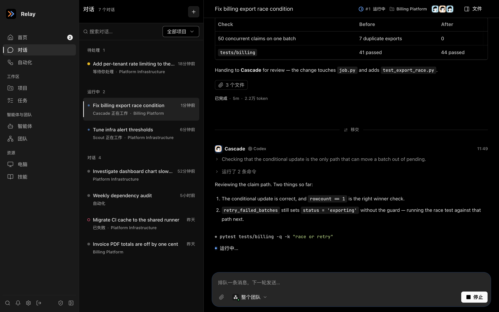
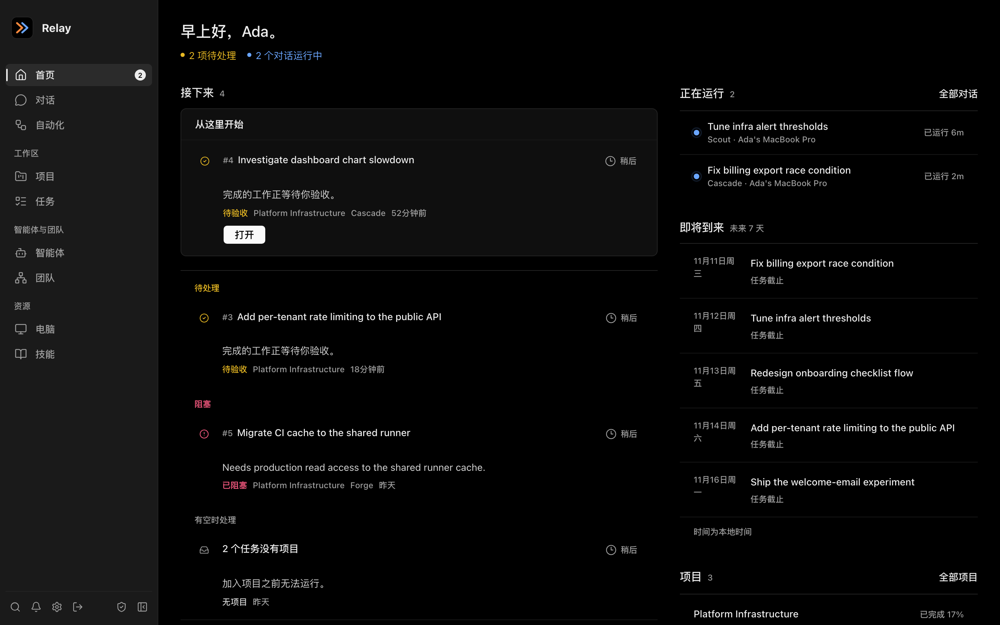
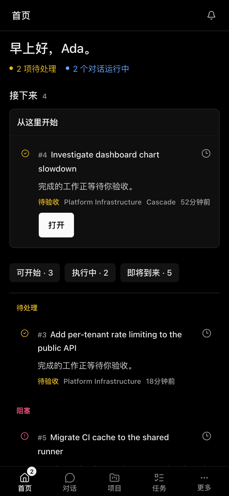
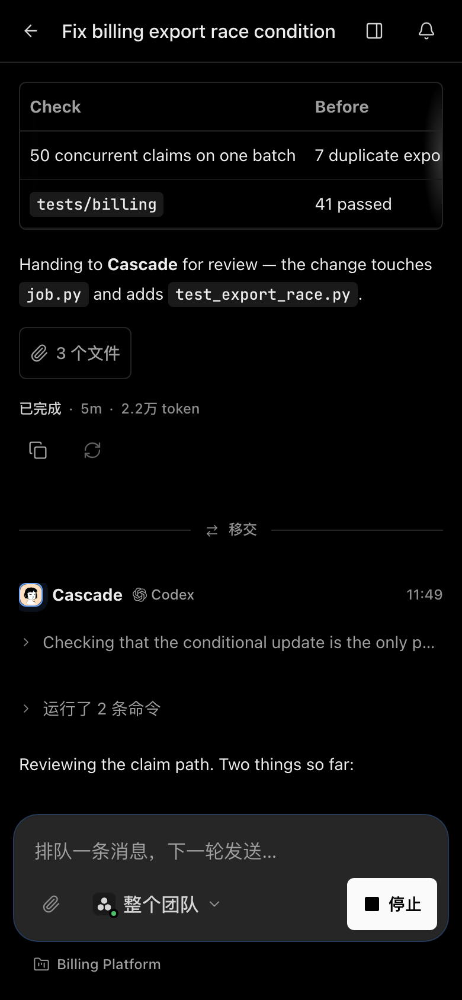
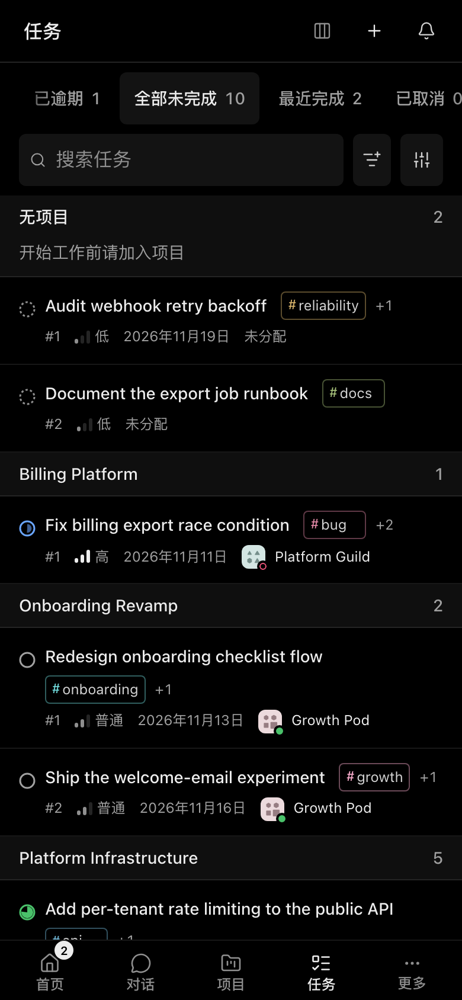

# Relay

<p align="center">
  
</p>

<p align="center"><strong>Relay——AI 团队的控制平面</strong></p>

<p align="center">
  <a href="README.md">English</a> ·
  <a href="README.zh-CN.md">简体中文</a> ·
  <a href="README.zh-TW.md">繁體中文</a>
</p>

在自己的计算机上运行 AI 智能体，将它们组织为团队，并随时通过桌面或手机跟进工作。Relay 支持 Codex、[Claude Code](https://github.com/anthropics/claude-code)、Pi、OpenCode 和 Kimi。

后端负责协调工作，守护进程在个人或托管计算机上执行，可直接使用主机环境，也可运行在 [BoxLite](https://github.com/boxlite-ai/boxlite) 沙箱中。

<p align="center">
  
</p>

## 功能特性

- **首页与对话** — 查看待处理事项，跟进实时输出，回答问题并审阅结果。
- **任务与项目** — 分配工作、设置优先级和截止日期，集中管理共享上下文、文件和运行历史。
- **智能体与团队** — 配置运行时、模型、角色和带版本的技能；支持单人、构建 → 评审、流水线和负责人主导协作。
- **自动化** — 按计划、任务或运行事件、Webhook 触发工作，也可手动立即运行。
- **连接与 MCP** — 为工作授予限定范围的 GitHub 议题读取权限。智能体可通过 Relay MCP 管理独立任务和自动化，项目负责人可管理项目工作。
- **计算机与管理** — 管理执行主机、运行时就绪状态、用户、活动和令牌用量。
- **桌面与移动端** — 使用适配手机的浏览器界面，或[将 Relay 安装为应用](docs/guides/pwa.md)。

## 界面预览

<p align="center">
  
</p>

<p align="center">
  
  
  
</p>

截图展示当前界面，使用深色主题和演示数据。通过 [`capture.mjs`](script/readme-snapshots/capture.mjs) 重新生成，添加 `--mobile` 可生成手机截图。

## 快速开始

你需要 Node.js 22.19+、npm、Python 3.12+、[uv](https://docs.astral.sh/uv/) 和 PostgreSQL。使用默认的 BoxLite 沙箱还需要 Docker、硬件虚拟化支持，以及所需智能体的凭据。

以下命令均在仓库根目录执行。

### 1. 安装与配置

```bash
npm install
npm run build
```

复制环境变量示例文件并填入智能体凭据（详见[本地开发指南](docs/local-development.md)）：

```bash
cp backend/.env.example backend/.env
cp web/.env.example web/.env.local
cp packages/.env.example packages/.env
```

### 2. 初始化数据库和管理员账户

Relay 将会话、任务、事件与产物存储在 PostgreSQL 中。先创建 `backend/.env` 中 `RELAY_DATABASE_URL` 指定的角色和数据库。示例使用 `localhost:5432` 上的角色 `relay` 和数据库 `relay`。然后运行数据库迁移：

```bash
make backend-migrate
```

创建第一个管理员账户（没有默认密码）：

```bash
script/init_users.sh --password 'choose-a-strong-password'
```

### 3. 启动服务

在不同终端中分别启动服务：

```bash
make backend                     # 控制平面，监听 127.0.0.1:8790
make daemon SANDBOX_ID=node_dev  # 连接后端的执行节点
make web                         # Web 界面，监听 127.0.0.1:5000
```

打开 <http://127.0.0.1:5000>，以 `admin` 身份登录。

测试、数据库迁移、协调器、pre-commit 钩子和停止命令请参阅[本地开发指南](docs/local-development.md)。

## 了解更多

[文档](docs/README.zh-CN.md) · [本地开发](docs/local-development.md) · [部署](deploy/README.md) · [参与贡献](CONTRIBUTING.md)

## 许可证

[Apache-2.0](LICENSE)。第三方组件和素材仍遵循各自的许可证。
