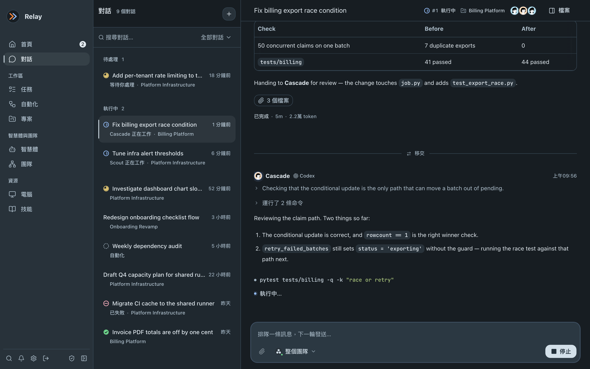
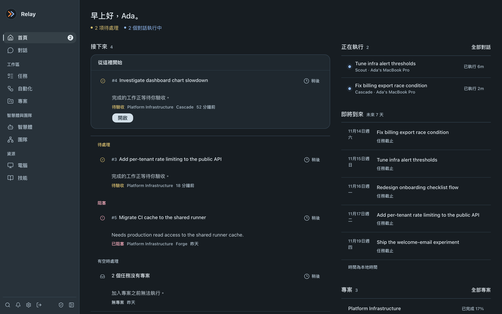
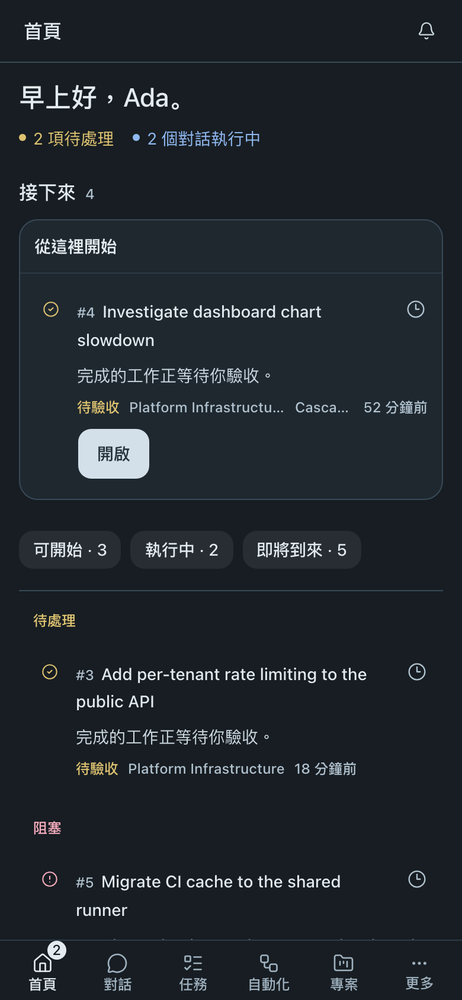
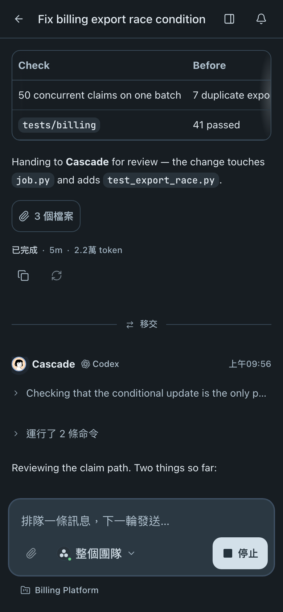
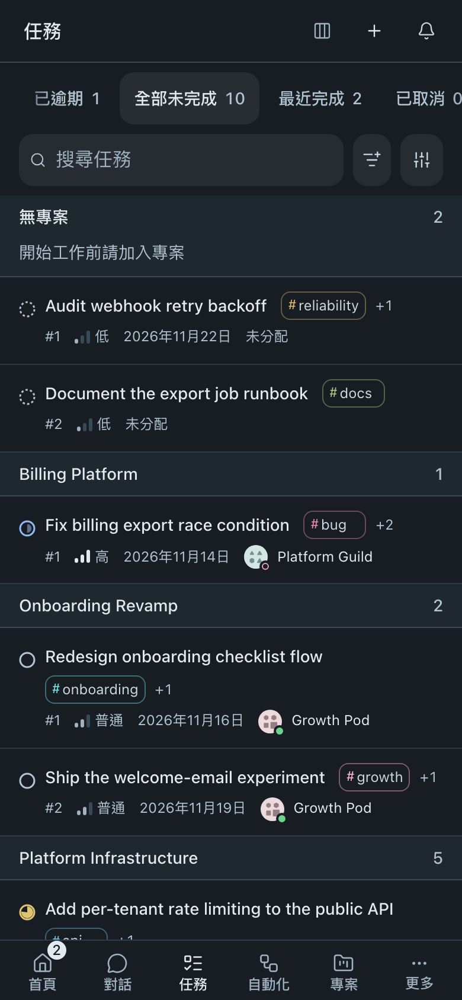

# Relay

<p align="center">
  
</p>

<p align="center"><strong>Relay——AI 團隊的控制平面</strong></p>

<p align="center">
  <a href="README.md">English</a> ·
  <a href="README.zh-CN.md">简体中文</a> ·
  <a href="README.zh-TW.md">繁體中文</a>
</p>

在自己的電腦上執行 AI 智慧體，將它們組織為團隊，並隨時透過桌面或手機追蹤工作。Relay 支援 Codex、[Claude Code](https://github.com/anthropics/claude-code)、Pi、OpenCode 和 Kimi。

後端負責協調工作，常駐程式在個人或受管理的電腦上執行，可直接使用主機環境，也可執行於 [BoxLite](https://github.com/boxlite-ai/boxlite) 沙箱中。

<p align="center">
  
</p>

## 功能特色

- **首頁與對話** — 檢視待處理事項，跟進即時輸出，回答問題並審閱結果。
- **任務與專案** — 指派工作、設定優先順序與截止日期，集中管理共享上下文、檔案與執行歷史。
- **智慧體與團隊** — 設定執行時、模型、角色與版本化技能；支援單人、構建與評審、流水線或負責人主導協作。
- **自動化** — 依排程、任務或執行事件、Webhook 觸發工作，也可手動立即執行。
- **連線與 MCP** — 為工作授予限定範圍的 GitHub Issue 讀取權限。智慧體可透過 Relay MCP 管理獨立任務與自動化；專案負責人可管理專案工作。
- **電腦與管理** — 管理執行主機、執行時就緒狀態、使用者、活動與令牌用量。
- **桌面與行動裝置** — 使用適配手機的瀏覽器介面，或[將 Relay 安裝為應用程式](docs/guides/pwa.md)。

## 介面預覽

<p align="center">
  
</p>

<p align="center">
  
  
  
</p>

截圖展示目前介面，使用深色主題與示範資料。透過 [`capture.mjs`](script/readme-snapshots/capture.mjs) 重新產生，加上 `--mobile` 可產生手機截圖。

## 快速開始

你需要 Node.js 22.19+、npm、Python 3.12+、[uv](https://docs.astral.sh/uv/) 和 PostgreSQL。使用預設的 BoxLite 沙箱還需要 Docker、硬體虛擬化支援，以及所需智慧體的憑證。

以下命令均在儲存庫根目錄執行。

### 1. 安裝與設定

```bash
npm install
npm run build
```

複製環境變數範例檔並填入智慧體憑證（詳見[本機開發指南](docs/local-development.md)）：

```bash
cp backend/.env.example backend/.env
cp web/.env.example web/.env.local
cp packages/.env.example packages/.env
```

### 2. 初始化資料庫與管理員帳戶

Relay 將對話、任務、事件與產物儲存在 PostgreSQL 中。先建立 `backend/.env` 中 `RELAY_DATABASE_URL` 指定的角色與資料庫。範例使用 `localhost:5432` 上的角色 `relay` 和資料庫 `relay`。然後執行資料庫遷移：

```bash
make backend-migrate
```

建立第一個管理員帳戶（沒有預設密碼）：

```bash
script/init_users.sh --email 'admin@example.com' --password 'choose-a-strong-password'
```

### 3. 啟動服務

在不同終端機中分別啟動服務：

```bash
make backend                     # 控制平面，監聽 127.0.0.1:8790
make daemon SANDBOX_ID=node_dev  # 連接後端的執行節點
make web                         # Web 介面，監聽 127.0.0.1:5000
```

開啟 <http://127.0.0.1:5000>，以 `admin` 身分登入。

測試、資料庫遷移、監督程式、pre-commit 鉤子與停止命令請參閱[本機開發指南](docs/local-development.md)。

## 瞭解更多

[文件](docs/README.zh-TW.md) · [本機開發](docs/local-development.md) · [部署](deploy/README.md) · [參與貢獻](CONTRIBUTING.md)

## 授權

[Apache-2.0](LICENSE)。第三方元件與素材仍遵循各自的授權條款。
