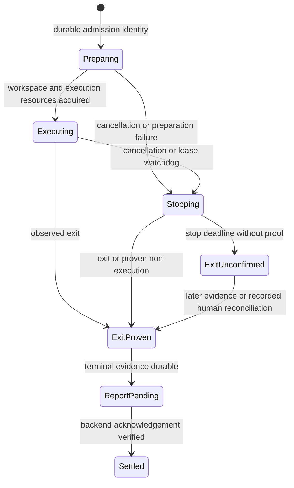

# Daemon reliability and runtime scaling

Status: implementation in progress, 2026-11-12. Runtime admission, extracted live
run supervision, HTTP retry/deadline transport, fail-closed critical background
tasks, and independent guest/boot budgets are implemented. Storage offloading,
complete lifecycle decomposition, production telemetry, and fleet rollout remain
unfinished. Synthetic measurements below are not production capacity claims.

One Computer retains one Daemon Node. Logical Agents retain their Placement,
while independent runs share the Computer's Agent Runtimes. The backend owns the
durable queue; the daemon owns execution and makes the final admission decision.

## Implemented runtime admission

`RELAY_DAEMON_MAX_CONCURRENT_RUNS` bounds all admitted runs on a Computer.
`RELAY_DAEMON_RUNTIME_LIMITS` optionally supplies positive integer limits by
runtime, for example:

```sh
export RELAY_DAEMON_MAX_CONCURRENT_RUNS=6
export RELAY_DAEMON_RUNTIME_LIMITS='{"codex":4,"claude":2}'
```

An omitted runtime inherits the Computer limit. A runtime limit above the
Computer limit is effectively capped by it. Unknown runtime names, malformed JSON,
and non-positive or non-integer values fail daemon startup. Background-service
runtime profiles preserve this setting. Restart the daemon after changing it.

The daemon advertises the effective limits in `executorCapabilities`. Registration
stores each limit in the existing `daemon_node_agents.details` JSON record, under
`maxConcurrentRuns`; no database migration is required. Backend delivery and the
transactional dispatch claim both enforce it. The latter takes the node-row mutex
and counts published runs plus unfinished dispatch claims, deduplicated by Thread.
This prevents two backend replicas from reserving the same remaining capacity.

Runtime saturation leaves an admitted assignment in the bounded backend queue,
without an execution reservation. Other runtimes and independent workspaces can
proceed. The existing Computer queue limit and Task Capacity still apply.

If the daemon's local view differs, it refuses before journaling or starting the
command. A backend advertising the `admission-retry` heartbeat feature receives
`run.failed` with `admissionRejected` equal to `computer-capacity` or
`runtime-capacity`. This is an explicit attestation of non-execution, carried by
the existing durable terminal outbox. The backend closes that command attempt,
keeps the assignment index and Task ownership, and retries with a fresh command
on recovery. A recorded stop takes precedence over retry. Ordinary failures keep
their existing behavior. With an older backend, the daemon retains the legacy
failed-start behavior; deploy the backend first.

Workspace locks remain authoritative. Shared Project workspaces serialize writes;
more run capacity does not enable concurrent edits to one Project directory.
Execution leases, journal reconciliation, and uncertain-exit reservations retain
their existing semantics. Permission prompts continue to occupy execution capacity.
Backend wait logs identify the runtime and distinguish workspace contention from
execution capacity. Admission rejection logs carry the explicit capacity reason.

## Implemented reliability changes

`run-supervisor.ts` owns active run identity, durable admission, workspace waits,
lease watchdog registration, process exit observation, cancellation, and durable
terminal handoff. `run-execution.ts` owns per-run preparation, execution, and
report construction; `run-events.ts` centralizes run-event identity fields.
`backend-transport.ts` owns existing HTTP deadlines and retry
behavior. `background-task.ts` makes unexpected heartbeat or replay termination
trigger a drain; an unexpected command-poll failure also stops active executions.
The entrypoint still owns recovery startup and transport feature negotiation.

Optional resource settings (restart required):

```sh
export RELAY_DAEMON_MAX_CONCURRENT_RUNS=5
export RELAY_DAEMON_MAX_GUESTS=3
export RELAY_DAEMON_MAX_CONCURRENT_BOOTS=1
```

Guest capacity defaults to run capacity; boot capacity defaults to guest capacity.
All three require positive integers. Background-service profiles preserve them.
Waiting for a guest remains admitted and cancellable. A timed-out boot continues
to occupy its boot budget until the underlying native operation settles; uncertain
cleanup continues to occupy its resident slot. Discovery shares these budgets.
These are local limits, with no wire/schema change or new backend retry reason.

`tools/benchmarks/daemon-runtime.mjs` characterizes durable admission/terminal
handoff at capacities 1, 5, and 20, and exact fence lookups with historical command
counts up to one million. Run after `npx tsc -p packages/tsconfig.json`:

```sh
node tools/benchmarks/daemon-runtime.mjs
```

An initial macOS arm64 / Node v26.8.2 run, while regression tests were running,
measured p99 event-loop delay of approximately 50 / 266 / 1,005 ms for those three
capacities. Each point completed 100 synthetic runs with retained terminal reports
and no pending execution journal. Cold lookup pairs (one existing and one missing
fence) stayed below 0.3 ms p99 at the three tested history sizes. This is a local
smoke baseline with concurrent-load noise, not an isolated performance study.

**Blocker to raising concurrency:** the 20-run burst exceeds the initial 600 ms
control-loop budget for a 6-second heartbeat. Keep the current default of five;
profile and offload synchronous persistence before recommending higher capacity.
Near-quota outbox reconstruction, prolonged outages, real Agent Runtimes, supported
host platforms, and representative production hardware still need characterization.

## Evidence and design priorities

Source paths below are relative to the repository root. These are structural
observations, not measured production bottlenecks.

| Current implementation | Implication for the revised design |
| --- | --- |
| `packages/relay-daemon/src/index.ts` was 2,716 lines before this revision. `runRelayDaemon` coordinates registration, admission, recovery, polling, reporting, cancellation, and shutdown; `executeCommand` now lives in `run-execution.ts`. | Extract ownership of lifecycle transitions, not just blocks of code. Callers should not coordinate several maps and abort controllers to stop one run safely. |
| `execution-journal.ts`, `admission-ledger.ts`, and `terminal-outbox.ts` already persist execution identity and reports. | Preserve these foundations. Replacing them with an in-memory queue would regress crash recovery. |
| `terminal-outbox.ts` bounds output bytes and record count, prioritizes terminal reports through `report-order.ts`, and batches negotiated uploads. `report-storage.ts` stops admission and producers under pressure. | Backpressure and fair replay already exist. Improve their measurable latency and failure isolation rather than proposing them as missing features. |
| Journal writes, admission fence writes/lookups, terminal retention, diagnostics, and some outbox work use synchronous filesystem operations. Output writes normally run asynchronously but spill synchronously above 4 MiB in flight. | Separate async loops still share an event loop. Slow storage can delay heartbeat, cancellation, and watchdog processing together. Measure event-loop delay under slow-disk and output-burst tests. |
| `AdmissionLedger.has` scans a hash bucket on a cache miss; resolved fences are deliberately retained indefinitely. Outbox construction enumerates and reads retained files. | Long-lived installation history and restart backlog are separate scaling dimensions from concurrent runs. Benchmark both before selecting a new storage format. |
| `guest-pool.ts` supports its own capacity, but the daemon supplies run capacity. It retains idle guests and refuses to reuse an unconfirmed guest slot. | Expose a separate guest budget without weakening cleanup proof. Bound simultaneous boots as well as resident guests. |
| The backend checks workspace contention in `daemon_registry/dispatch/delivery.py`; locally, admission precedes `WorkspaceRunGate.run`. | Backend avoidance is already present. Races or older peers can still leave admitted runs waiting locally; preserve a bounded fallback instead of adding an unbounded second queue. |
| `CommandTasks` bounds auxiliary work; heartbeat, replay, diagnostics, and discovery have separate asynchronous tasks. | Preserve these lanes. Make unexpected task termination observable and define recovery; independent promises alone are not fault isolation. |

Priorities, in order: preserve execution safety, isolate lifecycle ownership,
bound resource use, then increase useful concurrency based on measurements.

## Target module ownership

Keep one Daemon Node per Computer and the existing `runRelayDaemon(options)`
entrypoint. Reduce the entrypoint to construction, startup ordering, and shutdown.
The names below describe proposed internal modules, not new product concepts or
wire resources.

| Module | Small interface | Owns and hides |
| --- | --- | --- |
| Daemon lifecycle | `start`, `stop`, `snapshot` | Recovery barrier, task supervision, drain ordering, shutdown deadline, failure health. |
| Control transport | `poll`, `heartbeat`, `register` | HTTP deadlines, reconnect policy, feature negotiation, credential rejection, lease observations. It never starts processes or frees execution reservations. |
| Run supervisor | `accept`, `cancel`, `observeLeases`, `drain`, `snapshot` | Active runs, duplicate fencing, workspace acquisition, execution watchdog, process/guest exit evidence, per-run cleanup, durable terminal handoff. |
| Report delivery | `capture`, `finish`, `replay`, `snapshot` | Existing outbox and ordering, durable-write receipts, output sequences, byte limits, verified acknowledgements, quarantine and replay. |
| Resource admission | `tryReserve`, `release`, `snapshot` | Atomic local Computer/runtime accounting and, in a later stage, guest/boot budgets. Releasing a permit requires the supervisor's verified transition. |
| Execution environment | Existing execution/environment interface | Host-process and BoxLite adapters, scoped workspaces, process-tree cancellation, and evidence of exit. |

Do not add a general plugin framework or duplicate the existing runtime registry.
The host-process and BoxLite adapters are the concrete variation that justifies
an execution seam. Keep configuration validated once at startup. Inject the clock,
transport, execution environment, and evidence storage where tests need to drive
failures; keep production policy in the owning module.

The run supervisor accepts commands without waiting for their execution to finish.
Its result distinguishes accepted, duplicate, safely rejected before execution,
and recovery required. Acceptance means the admission identity is durable and
capacity is reserved, not that a process has started. Report capture exposes a
durability receipt separately from backend acknowledgement. A successful enqueue
must never be treated as a successful disk flush.

Initially compose the existing journal, ledger, outbox, and workspace gate behind
these interfaces. Do not replace storage and extract lifecycle ownership in the
same change. Avoid a supervisor constructor with dozens of independent callbacks:
pass the small owning modules and keep run-specific preparation inside it.

## Lifecycle and safety contract

These are internal phases, not new public Thread statuses:



A crash can leave the last durable phase behind actual process state. On restart,
reconcile evidence before accepting new runs; never infer non-execution merely
because a later phase or process identifier was not persisted. The diagram's
`ExitProven` includes the existing auditable human reconciliation path, which must
remain distinguishable from observed process exit in records and reports.

Required ordering and failure behavior:

1. Validate command identity, workspace scope, and capacity before starting work.
   Serialize admission locally so concurrent acceptance cannot oversubscribe.
   Persist the journal and duplicate fence before any process can spawn. Failure
   between these writes fails closed; recovery consults both stores.
2. Acquire the workspace gate before execution. Waiting for a workspace, permission,
   guest boot, or cleanup remains admitted work. It cannot evade the Computer cap.
3. Persist available process or guest identity. Failure to record identity is a
   recovery fault, never permission to launch a replacement. Preserve the existing
   conservative handling of the spawn-to-identity-persistence crash window.
4. Lease expiry requests stop; it is not exit evidence. A delivered start is never
   automatically reissued because its heartbeat is missing. Unconfirmed execution
   keeps its reservation and workspace protected until evidence or the existing
   recorded reconciliation action authorizes release.
5. Once exit is verified, persist the original terminal outcome before retiring
   recovery evidence. HTTP failure cannot replace that outcome with cancellation.
   Local capacity can be released after durable exit reporting without waiting for
   upload; backend reservation release follows backend acceptance or reconciliation.
6. Preserve output ordering per command/lease and the terminal output watermark.
   Terminal evidence can upload before late output; terminal acceptance must not
   delete still-unacknowledged output. The backend deduplicates replayed reports.
7. A persistence failure closes admission and requests bounded shutdown of producers.
   Preserve retained evidence; do not rotate it away to make a health check green.
   Corruption is a recovery incident, not an empty journal or successful exit.

Shutdown first closes local admission, attempts the existing draining heartbeat
within a deadline, cancels preparations and executions, waits for exit evidence,
and flushes durable reports within the shutdown budget. Backend unavailability
must not prevent local stopping. Persist unresolved identities, then close the
execution environment and transport. A cleanup timeout never frees an uncertain
process or guest slot. Restart uses those identities for recovery.

## Resource and scheduling policy

Keep the durable backlog in the backend. Daemon admission is the final local
check, not a competing task scheduler. Keep current runtime limits and defaults
through the extraction stage.

Introduce separate, validated budgets only after measurement:

- Computer admitted-run count and per-Agent-Runtime count, as today.
- Resident BoxLite guests, including booting and uncertain-retirement guests.
- Concurrent guest boots, to prevent startup CPU and disk spikes.
- Report bytes, report count, pending-write bytes, and free filesystem space,
  retaining the existing terminal reserve and hysteresis.
- Bounded auxiliary command work and runtime discovery concurrency.

A guest permit and a run permit are different resources. With fewer guests than
run slots, preparing runs may wait for a guest, remain counted, and remain
cancellable. Idle guests may be evicted; active or uncertain guests may not.
Discovery must share the boot budget. A host-process Computer has no guest budget.
Resource estimates for memory and CPU are admission hints until the execution
adapter can enforce them; do not advertise hard isolation for host processes.

Retain backend workspace contention checks and fair progress across available
runtimes. Measure oldest runnable queue age, including workloads where one Project
is busy and others are idle. If bounded queue scans repeatedly skip eligible work,
add a durable rotating cursor or equivalent fairness policy at backend dispatch;
do not assume an in-memory cursor is sufficient across replicas. Local workspace
waiting is only a bounded fallback for races and compatibility.

Provider throttling, if observed, should pause only new work for the affected
runtime/credential scope. Use a bounded cooldown with jitter and a probe to resume;
never kill healthy executions or expose credential values in metrics. This is
later policy work, not part of the initial extraction.

## Storage and background-task scalability

Measure first: event-loop delay, durable-write latency, restart reconstruction
latency, fence lookup latency, and report backlog age at realistic history sizes.
Do not relax `fsync` or delete fences to improve a benchmark.

If disk work violates the control-loop budget, introduce a bounded persistence
worker behind report delivery and admission storage. A worker's reply must mean
flush completion; worker death or a missing reply fails closed. Reserve space for
terminal evidence and stop producers before the bounded ingress queue fills.
Never fall back to unlimited memory. A worker alone does not solve slow disks;
retain storage-pressure admission and stop policy.

Consider an indexed local store or segmented append log only if history/restart
benchmarks justify the migration. Any format must preserve exact command fences,
checksummed records, verified acknowledgement, and crash-safe recovery. Do not age
out resolved command identities without a protocol-backed safe deletion rule.
A format change needs a separate migration design, interrupted-migration tests,
and a rollback path that cannot hide executions admitted by the newer daemon.

Supervise heartbeat, polling, replay, and discovery explicitly. Retry expected
transport errors with bounded backoff and jitter. An unexpected background-task
exit must update health and either restart under a bounded policy or close
admission; logging a dead critical task while accepting new work is insufficient.
Recovery must never leave two polling or replay loops active. Control traffic and
terminal evidence retain priority over bulk output and diagnostics.

## Observability and validation gates

Use bounded-cardinality metric labels: runtime, sandbox mode, phase, and reason.
Keep command, Thread, and lease identifiers in structured logs/diagnostics, with
secrets and prompts excluded. Record:

- Admission refusals, preparing/executing/stopping/unconfirmed counts, workspace
  wait, guest wait, startup duration, and oldest runnable backend queue age.
- Heartbeat/poll latency, confirmed lease headroom, event-loop delay, replay age,
  retained bytes/count, durable-write latency, and rejected/corrupt report count.
- Stop-to-exit duration, shutdown duration, recovery duration, guest boots and
  evictions, process memory, and child-process resource usage where measurable.

Use a controllable clock, fault-injecting transport, and both execution adapters.
Extend existing tests instead of asserting private map layout or file boundaries.

| Scenario | Required result |
| --- | --- |
| Duplicate start; crash after either admission write, after spawn, or before terminal acknowledgement | No replacement execution without proof; original outcome and fences survive restart. |
| Lost poll/heartbeat response; expired lease; backend restart or two replicas | Correct lease identity; no inferred exit or duplicate reservation release. |
| Cancellation during workspace wait, guest boot, permission prompt, output flood, or shutdown | Stop remains responsive; unconfirmed exit remains reserved. |
| Disk full, slow flush, torn record, persistence worker failure | Admission closes; evidence survives; no successful durability receipt for failed storage. |
| 429/5xx, permanent rejection, outage and reconnect with a large outbox | Bounded memory/disk; terminal priority and output ordering; quarantine remains visible. |
| Hot Project alongside independent Projects and mixed runtimes | Eligible independent work progresses; local/back-end limits hold; one writer per workspace. |
| Late guest boot, failed teardown, daemon restart on Windows and Unix | No uncertain slot reuse; platform-specific exit evidence is respected. |
| Unexpected replay/heartbeat task termination | Visible degraded health and bounded recovery or admission closure. |

Benchmark run capacities 1, 5, and 20; small and near-quota report backlogs; and
fence histories of 10 thousand, 100 thousand, and 1 million commands. These are
experiment points, not supported capacity claims. Include a prolonged backend
outage and reconnect burst. Use a disposable backend database and synthetic
execution adapters for repeatability, then validate representative real runtimes
and BoxLite on supported hosts. Do not seed production server state.

Before raising defaults, require zero duplicate executions, zero premature
reservation releases, bounded storage/memory, and no runnable-work starvation in
the fault matrix. As an initial control-loop gate, require p99 event-loop delay
below one tenth of the negotiated heartbeat period and no healthy-network lease
loss under the chosen sustained load. Record hardware, workload, duration, p99
queue/start/cancel latency, and backlog recovery time. Publish measured limits;
select latency objectives from the baseline rather than claiming an untested SLA.

## Implementation sequence and compatibility

1. **Characterize and instrument.** Add lifecycle/failure characterization tests
   around `runRelayDaemon`, and collect the baseline metrics above. Reuse
   `execution-recovery`, `execution-journal`, `admission-ledger`, `terminal-outbox`,
   `runtime-lifecycle`, `workspace-run-gate`, and `run-admission` test suites.
2. **Extract the run supervisor.** Move ownership of active runs, preparation,
   cancellation, watchdogs, and terminal handoff together. Preserve wire behavior,
   disk format, defaults, and the public entrypoint. Gate on recovery and shutdown
   tests, not line count alone.
3. **Extract transport and supervise background tasks.** Keep deadlines and
   priority independent of run completion. Test task failure and restart without
   duplicate loops. No new backend feature is required for this extraction.
4. **Separate guest/boot budgets.** Start opt-in; preserve existing effective
   defaults. Advertise new resource hints only through negotiated capabilities.
   Older peers keep existing admission behavior; local limits remain authoritative.
5. **Optimize evidenced bottlenecks.** Add bounded persistence offloading or a
   separately reviewed storage migration only when measurements require it. Adjust
   backend fairness or provider cooldown only with corresponding failure tests.

For each implementation stage, compile and run focused daemon tests, then the
full TypeScript and Python suites per the navigation guide. For wire changes,
update `relay-core` types, Python parsing and capability vocabulary, backend
admission/recovery tests, and operational docs together. New retryable rejection
reasons require backend support first: an older peer must not interpret a resource
wait as a terminal task failure. Include mixed-version tests before rollout.

Canary on a small set of Computers, comparing lease headroom, recovery incidents,
queue age, and report backlog against baseline. Stop rollout on any safety-gate
failure. Drain before binary downgrade; retain journals/outboxes. With unchanged
wire and storage formats, earlier binaries remain the rollback target. Never
roll back across a new storage format until its separate migration contract proves
that pending evidence remains readable.

This proposal preserves [ADR-009](../adr/009-control-plane-outside-sandbox.md),
[ADR-010](../adr/010-leased-agent-node-delivery.md), and
[ADR-017](../adr/017-computer-bound-project-workspaces.md). No accepted domain
concept changes, so `CONTEXT.md` does not change. Isolated Project worktrees would
reconsider ADR-017 and require a separate integration design and glossary update.
Do not move Threads between Computers or bypass Placement for load balancing.
Scale independent work across additional Computers through existing enrollment
and Placement. Persistent runtime services need evidence that CLI startup cost
outweighs their isolation and recovery cost.
